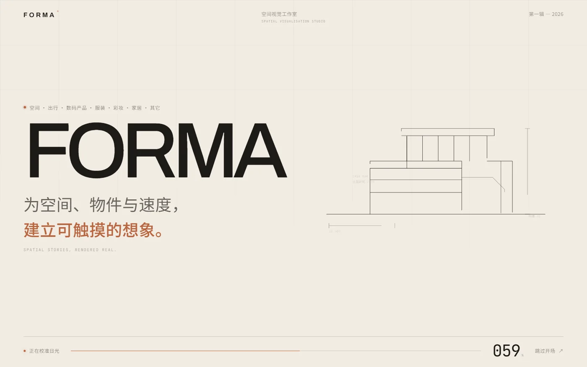
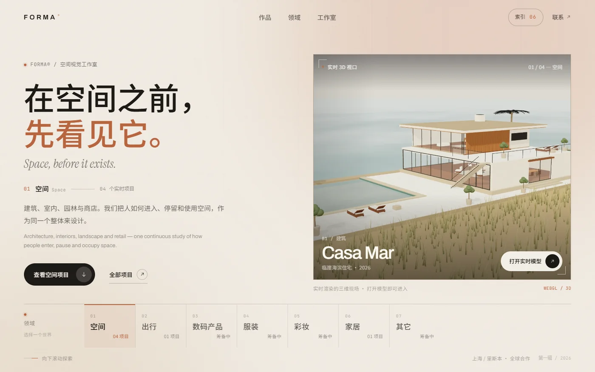
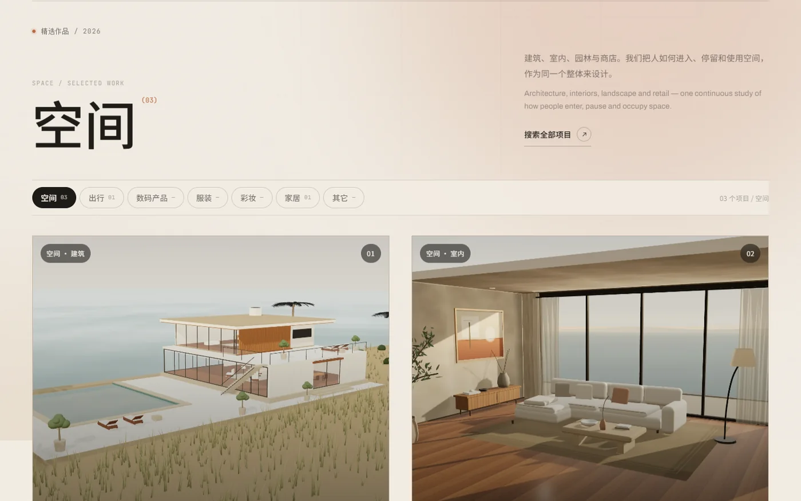
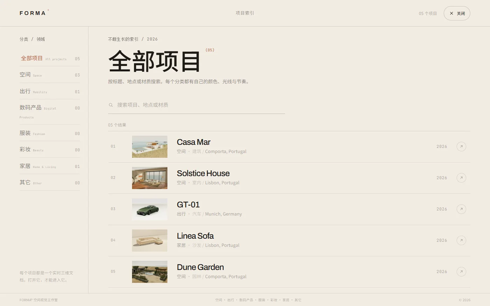
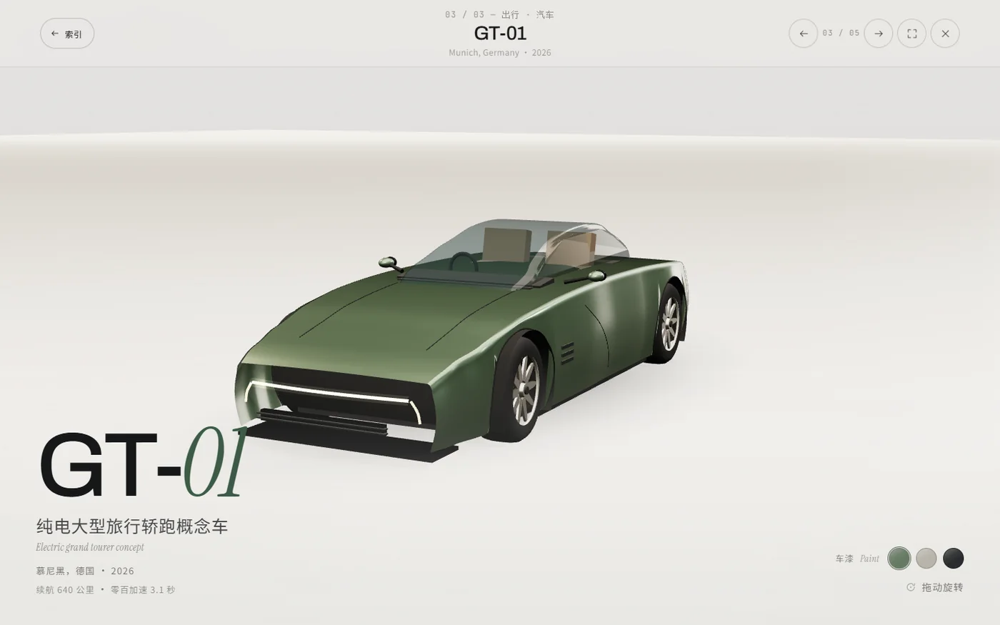
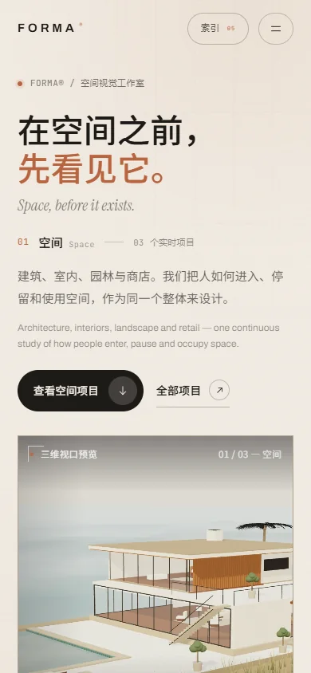

# FORMA® — 空间视觉工作室

一个中文优先、分类驱动的创意空间设计公司官网。空间（建筑 / 室内 / 园林 / 商店）、出行（汽车 / 摩托）、数码产品、服装、彩妆、家居与其它，每个大类拥有自己的光、颜色和标题；进入类别后，再选择具体项目加载实时三维场景。

> 视觉：当代编辑式排版、暖纸底色、领域主题色、大字号中文标题、实时 3D 预览。
>
> 技术：React 19 + TypeScript + Vite + Three.js；子项目为原生 HTML/CSS/JS，按需 iframe 加载。
>
> 导航：领域栏 / 领域索引 / 分类作品 / 全屏项目索引（分类 + 搜索）。
>
> 部署：Vercel 多页构建。

---

## 预览





| 作品筛选 | 项目索引 |
| --- | --- |
|  |  |

| 沉浸式项目查看器 | 移动端 |
| --- | --- |
|  |  |

---

## 当前类别与项目

| 大类 | 包含的细分类型 | 当前项目 |
| --- | --- | --- |
| 空间 · Space | 建筑 / 室内 / 园林 / 商店 | Casa Mar（建筑）、Solstice House（室内）、Dune Garden（园林） |
| 出行 · Mobility | 汽车 / 摩托 | GT-01（汽车） |
| 家居 · Home & Living | 家居 / 家具 | Linea Sofa（沙发） |
| 数码产品 · Digital Products | 数码产品 / 界面 | 新作筹备中 |
| 服装 · Fashion | 服装 / 面料 | 新作筹备中 |
| 彩妆 · Beauty | 彩妆 / 香氛 | 新作筹备中 |
| 其它 · Other | 未分类项目 | 新作筹备中 |

类别顺序、中文/英文名、首页标题、介绍与主题色集中维护在：

```text
src/lib/categories.ts
```

项目在 `project.json` 中通过 `category` 选择大类，通过可选字段 `type` 标记细分类型（如“建筑”“室内”“汽车”）。新增类别或新项目后，首页类别栏、领域索引、作品筛选、项目索引会自动更新，不需要改路由。

---

## 目录结构

```text
building-web/
├─ index.html                    # React 官网入口
├─ src/
│  ├─ App.tsx                    # 页面编排、分类/主题状态、懒加载
│  ├─ components/
│  │  ├─ Intro.tsx               # 开场动画（建筑立面线稿 + 中文标题）
│  │  ├─ SiteHeader.tsx          # 导航 + 移动端菜单
│  │  ├─ LivePreview.tsx         # 首页实时 3D 视口（按分类加载）
│  │  ├─ CategoryRail.tsx        # 首页领域切换
│  │  ├─ DisciplinesSection.tsx  # 完整领域索引
│  │  ├─ WorksSection.tsx        # 分类内作品列表 / 筛选
│  │  ├─ ProjectCard.tsx         # 项目卡片（封面图）
│  │  ├─ ArchiveOverlay.tsx      # 全屏项目索引（分类 + 搜索）
│  │  ├─ ProjectViewer.tsx       # 全屏按需项目运行时
│  │  ├─ StudioSection.tsx       # 工作室介绍 / 工作方式 / 联系
│  │  └─ SiteFooter.tsx
│  ├─ lib/categories.ts          # ★ 分类主题与文案配置
│  └─ styles/global.css
├─ apps/                         # ★ 所有子项目统一放在这里
│  ├─ casa-mar/                  # 子项目 01 · 原生 JS + Three.js
│  ├─ solstice-house/            # 子项目 02
│  ├─ gt-01/                     # 子项目 03
│  ├─ linea-sofa/                # 子项目 04
│  ├─ dune-garden/               # 子项目 05
│  └─ _template/                 # 新项目模板（不会参与构建）
├─ docs/
│  ├─ adding-a-study.md          # 新项目完整指南
│  └─ preview/                   # README 截图
├─ vite.config.ts                # 自动发现 apps/ 下项目 + 多页构建
└─ vercel.json
```

**根目录是官网主体；所有子项目统一放在 `apps/` 下。**

---

## 核心机制

### 1. 分类驱动的网站主题

选择领域（或悬停领域/项目）时，网站会平滑切换：

- 页面背景、光晕、文字强调色；
- 首页中文主标题与英文副标题；
- 领域介绍与项目列表；
- 项目卡与查看器配色。

主题来自 `src/lib/categories.ts` 的分类配置，项目自己的 `theme` 用于查看器和子项目。

### 2. 先分类，后项目

首页领域栏 → 切换分类 → 查看该分类下的项目 / 实时预览 → 打开完整三维项目。

当项目数量增长时：

- 顶部导航不再塞入所有项目；只保留「作品 / 领域 / 工作室 / 索引」。
- 首页有可横向滑动的领域栏，适合任意数量分类。
- 「领域」区块列出所有分类及数量，可快速进入。
- 「作品」区块支持分类筛选与分页加载。
- 「索引」全屏面板支持 **分类 + 搜索 + 滚动列表**，适合几十个项目。

### 3. 真正的按需 3D 加载

- 桌面端首页只加载当前类别的第一件项目作为实时预览（一个 iframe）；手机首屏改用轻量封面静帧，点击后再进入完整 3D，避免首屏 WebGL 与索引 / 菜单抢性能。
- 打开索引或查看器时，预览 iframe 只做隐藏暂停，不再反复卸载重载；关闭后立即恢复。
- 滚动离开首屏后，预览 iframe 会卸载；滚回再按需重新加载。
- 打开某个项目才加载对应页面；关闭或切换时立刻卸载旧 iframe，释放 WebGL context / 纹理 / 几何体。
- 首页只读取体积很小的项目封面图；真正的 3D 页面只在打开对应项目时才加载。

### 4. 开场动画

纯 CSS/SVG 建筑立面线稿 + FORMA 字标 + 中文标题 + 进度条，不阻塞于 WebGL 初始化。约 3 秒进入网站，支持跳过和 `prefers-reduced-motion`。

### 5. 中文优先与移动端

- 中文为主标题和主要信息，英文作为小号次级信息。
- 正文字号 14–16px，微标签不小于约 10–12px，避免“看不见”。
- 移动端重新排版：大字标题、单列内容、横向滑动的领域栏、全屏菜单与可搜索项目索引。
- 已在 1440×900、1280×800、1024×768、820×1000、390×844、844×390 等尺寸检查。

---

## 快速开始

要求 Node.js 20.19+。

```bash
npm install
npm run dev       # http://localhost:5173
npm run build     # 类型检查 + 生产构建
npm run preview   # 本地预览 dist
```

单独访问某个项目：

```text
http://localhost:5173/apps/casa-mar/
http://localhost:5173/apps/solstice-house/
http://localhost:5173/apps/gt-01/
http://localhost:5173/apps/linea-sofa/
http://localhost:5173/apps/dune-garden/
```

---

## 新增项目

推荐直接复制模板：

```powershell
Copy-Item -Recurse apps\_template apps\my-project
```

然后：

1. 修改 `apps/my-project/project.json` 的标题、中文副标题、分类、主题色、排序；
2. 修改 `main.js` 的三维场景；
3. 修改 `index.html` / `style.css` 的中文覆盖层；
4. 可选：用 `http://localhost:5173/apps/my-project/?cover=1` 截图，另存为 `cover.webp`，在 `project.json` 写 `"cover": "cover.webp"`。

> 如果使用新的分类，先在 `src/lib/categories.ts` 中添加分类配置（中英文、标题、介绍、主题色）。

完整字段说明、分类约定、`?cover=1` 和检查清单见 [`docs/adding-a-study.md`](docs/adding-a-study.md)。

---

## 部署到 Vercel

项目已包含 `vercel.json`：

- Framework：Vite
- Build Command：`npm run build`
- Output Directory：`dist`

```bash
npx vercel --prod
```

或把仓库导入 Vercel 后使用默认设置。多页构建会输出：

```text
/                       → React 官网
/apps/casa-mar/
/apps/solstice-house/
/apps/gt-01/
/apps/linea-sofa/
/apps/dune-garden/
```

---

## 技术栈

React 19 · TypeScript · Vite 7 · Three.js r180 · 原生 JavaScript 子项目 · Vercel

字体：Archivo Variable（拉丁无衬线）/ Instrument Serif（英文衬线强调）/ JetBrains Mono（微标签），中文使用系统中文字体栈 PingFang SC / Noto Sans SC / Microsoft YaHei。


